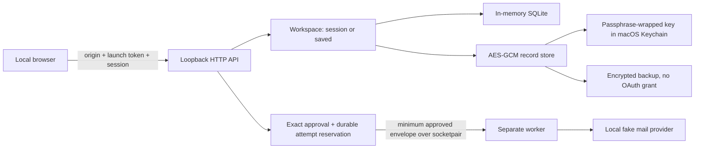

# Architecture and decisions

The UI process denies covered outbound network and child-process calls after
initialization. The worker is spawned first and applies its own narrower guard.
Neither audit hook is an OS sandbox. Broker emails reach only the fake provider;
the Gmail implementation permits only messages to the connected account itself.

| Decision | Reason and tradeoff |
| --- | --- |
| Local Python, SQLite, HTML/CSS/JavaScript | Small inspectable stack; native lifecycle and browser behavior still need platform testing |
| Session mode separate from saved vault | Retention is explicit; ending a session loses its history and duplicate evidence |
| Native Keychain holds a wrapped key | Passphrase is required to unwrap; same-user/OS compromise remains outside scope |
| Fixed contract templates and minimum payloads | Limits what the worker receives; each new route needs evidence and maintenance |
| Reserve before dispatch | Prevents concurrent double sending; interruption may leave an uncertain attempt requiring reconciliation |
| Immutable disclosure snapshots | Later edits cannot change what a prior request revealed; history itself is sensitive |
| Separate recovery passphrase and new restore keys | Restore need not possess the original Keychain; forgotten recovery secrets are unrecoverable |

## Code map

- `workspace.py`, `vault.py`, `key_store.py`: retention, encryption and native key lifecycle.
- `identity.py`, `cases.py`, `workflow.py`: shared identity, history and batch planning.
- `contracts.py`, `routes.py`, `requirements.py`: explicit route evidence and eligibility.
- `execution.py`, `dispatch.py`, `worker.py`, `gmail.py`: authorization, durable outbox and transport.
- `recovery.py`: bounded authenticated backups, fresh-key restore and reconciliation.
- `local_http.py`, `private_server.py`, `network.py`: loopback request and process guards.

The [threat model](THREAT_MODEL.md) and [test map](SECURITY_VALIDATION.md) explain
what these choices establish and what remains outside their protection.
